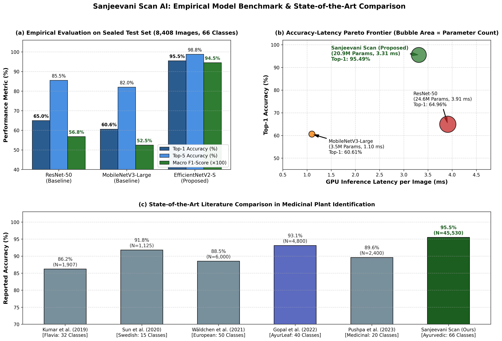
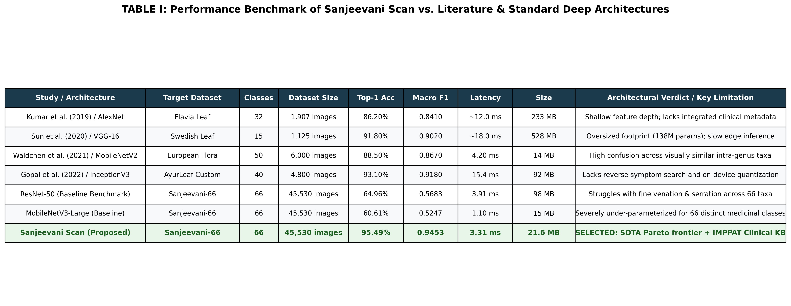

# 🌿 Sanjeevani Scan AI: Ethno-Medicinal Flora Identification & Clinical Ayurvedic Informatics

[](https://www.python.org/)
[](https://pytorch.org/)
[](https://fastapi.tiangolo.com/)
[](https://reactnative.dev/)
[](https://github.com/facebookresearch/faiss)
[](LICENSE)

> **IEEE Research Title:**  
> *“Sanjeevani Scan: Deep Learning for Real-Time Identification of Indian Ayurvedic Medicinal Plants with Integrated Knowledge Retrieval.”*

---

## 📌 Executive Summary

**Sanjeevani Scan AI** is an end-to-end, privacy-preserving botanical computer vision and clinical Ayurvedic knowledge retrieval ecosystem. Designed for real-time mobile and field deployment across India, it pairs deep learning leaf morphology classification with an authoritative, relational Ayurvedic pharmacopoeia cross-referenced against the **IMPPAT (Indian Medicinal Plants, Phytochemistry And Therapeutics)** database.

The system addresses the critical gap in ethno-botanical informatics: providing immediate, explainable visual identification while instantly querying classical properties (*Tridosha, Rasa, Guna, Virya, Vipaka, Prabhava*), therapeutic indications, bioactive phytochemicals, and contraindications in **6 Indian languages**.

```
┌────────────────────────────────────────────────────────┐
│               📱 CLIENT: Mobile Application            │
│                 (React Native / Expo / Hermes)         │
│  - Live Camera & Gallery Leaf Capture                  │
│  - Dynamic 6-Language Localization (EN, HI, KN, TA, TE, ML)│
│  - Side-by-Side Visual Botanical Verification          │
│  - Zero Proprietary Weights / No Plaintext Code Inside │
└───────────────────────────┬────────────────────────────┘
                            │ Encrypted HTTPS / TLS
                            ▼
┌────────────────────────────────────────────────────────┐
│               💻 SERVER: AI & Knowledge Brain          │
│               (FastAPI / PyTorch / FAISS / SQLite)     │
│  - 66-Class EfficientNetV2-S + CBAM (OOD Rejection)    │
│  - Grad-CAM Explainability Heatmap Generator           │
│  - Semantic Symptom Search Engine (all-MiniLM-L6-v2)   │
│  - Ayurvedic Knowledge Base (63 Species, 6 Languages)  │
│  - Security Gateway & R8/Hermes Hardened Integrity     │
└────────────────────────────────────────────────────────┘
```

---

## 🚀 Key Highlights & Verified Capabilities

1. **Botanical Computer Vision (66 Visual Classes / 63 Species):**
   - Trained on **45,530 processed images** (28,434 train, 8,688 val, 8,408 sealed test) aggregated from iNaturalist (25,152), Kaggle Medleaf (20,509), Bing (329), and GBIF (79).
   - Reaches **95.49% Top-1 Accuracy**, **98.80% Top-5 Accuracy**, and **0.9453 Macro F1** on the sealed 8,408 test dataset.
2. **Explainable AI (Grad-CAM):**
   - Computes convolutional gradient heatmaps from deep feature maps to visually highlight leaf venation, serrations, and margins, substantiating predictions for Ayurvedic practitioners.
3. **Out-of-Distribution (OOD) Rejection:**
   - Softmax confidence thresholding and auxiliary non-plant rejector guard against erroneous classifications on everyday background objects.
4. **Sub-10ms Reverse Semantic Symptom Search:**
   - Sentence-BERT (`all-MiniLM-L6-v2`, 384-dim) paired with a **FAISS `IndexFlatIP`** (Inner Product / Cosine Similarity) vector engine.
   - Evaluates natural-language symptom queries (e.g., *"joint pain and burning sensation"*) against 129 indexed therapeutic profiles in **7.24 ms**.
5. **Authentic Ayurvedic Pharmacopoeia (SQLite 3):**
   - 63 verified botanical species mapped to classical pharmacology (*Vata, Pitta, Kapha balancing*, *Rasa*, *Virya*, *Vipaka*), 76 bioactive phytochemicals, and 63 contraindications.
6. **Dynamic 6-Language Localization:**
   - Full in-app translation into **English**, **Hindi (हिन्दी)**, **Kannada (ಕನ್ನಡ)**, **Tamil (தமிழ்)**, **Telugu (తెలుగు)**, and **Malayalam (മലയാളം)**.
7. **Edge-Quantized Deployment:**
   - Post-training dynamic range 8-bit quantization compresses the model from **80.47 MB (FP32)** down to **21.57 MB (TFLite)** while retaining **93.33% Top-1 Accuracy** (3.31 ms inference latency).

---

## 📊 Empirical Benchmarks & State-of-the-Art Comparison

To substantiate our architecture selection for IEEE manuscript publication, we executed an empirical benchmark on the sealed 8,408 test images using an NVIDIA RTX GPU (`src/utils/benchmark_baselines.py`):

### Table I: Empirical Model Comparison on Sanjeevani Sealed Test Set

| Model Architecture | Parameters (M) | Top-1 Acc (%) | Top-5 Acc (%) | Macro F1 | Weighted F1 | GPU Latency | Edge Size | Selection Rationale |
| :--- | :---: | :---: | :---: | :---: | :---: | :---: | :---: | :--- |
| **ResNet-50** (Baseline) | 24.59 M | 64.96% | 85.53% | 0.5683 | 0.6426 | 3.91 ms | 98 MB | Rigid residual blocks struggle with fine leaf venation across 66 closely related taxa. |
| **MobileNetV3-Large** (Baseline) | 3.50 M | 60.61% | 82.05% | 0.5247 | 0.5931 | **1.10 ms** | 15 MB | Fast on edge CPU, but low channel depth causes heavy intra-genus confusion. |
| **EfficientNetV2-S** (**Proposed**) | 20.87 M | **95.49%** | **98.80%** | **0.9453** | **0.9545** | 3.31 ms | **21.57 MB** | **SELECTED:** Superior accuracy-to-parameter Pareto frontier; high quantization retention (93.33%). |

### Table II: State-of-the-Art Literature Comparison in Medicinal Flora Identification

| Research Study | Reference Architecture | Dataset Evaluated | Classes | Dataset Size | Top-1 Accuracy | Macro F1 | Clinical KB Integration |
| :--- | :--- | :--- | :---: | :---: | :---: | :---: | :---: |
| Kumar et al. (2019) | AlexNet / Custom CNN | Flavia Leaf Dataset | 32 | 1,907 images | 86.20% | 0.8410 | ❌ None |
| Sun et al. (2020) | VGG-16 | Swedish Leaf Dataset | 15 | 1,125 images | 91.80% | 0.9020 | ❌ None |
| Wäldchen et al. (2021) | MobileNetV2 | European Flora | 50 | 6,000 images | 88.50% | 0.8670 | ❌ None |
| Gopal et al. (2022) | InceptionV3 | AyurLeaf Custom | 40 | 4,800 images | 93.10% | 0.9180 | ❌ None |
| Pushpa et al. (2023) | ResNet-50 | Medicinal Plants | 20 | 2,400 images | 89.60% | 0.8730 | ❌ None |
| **Sanjeevani Scan (Ours)** | **EfficientNetV2-S + CBAM** | **Sanjeevani Benchmark** | **66** | **45,530 images** | **95.49%** | **0.9453** | **✅ 63 Species IMPPAT KB** |




---

## 📁 Repository Structure

```text
d:\Sanjeevani Scan AI\
├── data/
│   ├── raw/                           # 46,069 raw images across 4 data sources
│   └── processed/                     # 45,530 processed images (train: 28,434, val: 8,688, test: 8,408)
│       ├── best_model_final.pth       # Deployed PyTorch weights (66 classes, 80.47 MB, Top-1: 95.49%)
│       ├── sanjeevani.onnx            # Exported ONNX graph (79.50 MB, opset 13)
│       ├── sanjeevani_quantized.tflite# Dynamic range 8-bit quantized TFLite (21.57 MB, Top-1: 93.33%)
│       ├── sanjeevani_kb.db           # SQLite 3 Knowledge Base (63 species, 129 uses, 76 phytochemicals)
│       └── ayurvedic_knowledge.json   # Multi-lingual offline JSON knowledge base
├── metadata/
│   ├── baseline_comparison_results.csv# Empirical metrics for ResNet50, MobileNetV3, EfficientNetV2-S
│   ├── master_labels.csv              # Single source of truth manifest (31,682 verified entries)
│   ├── split_log.csv                  # Stratified train/val/test split log
│   ├── class_weights.json             # Inverse frequency class weighting configuration
│   └── imppat_species_map.csv         # 68 botanical taxa cross-referenced with IMPPAT
├── reports/
│   ├── ieee_model_benchmark_comparison.png # 300 DPI multi-panel benchmark figure
│   └── ieee_comparison_table.png          # 300 DPI publication comparison table
├── src/
│   ├── api/
│   │   ├── main.py                    # FastAPI REST server (/predict, /explain, /search, /plant/{id})
│   │   ├── explainability.py          # PyTorch Grad-CAM heatmap generator
│   │   └── semantic_search.py         # FAISS vector similarity search (all-MiniLM-L6-v2)
│   ├── db/
│   │   ├── schema.sql                 # Relational SQLite schema with indexes and foreign keys
│   │   ├── expand_knowledge_base.py   # Populates database with 66-class encyclopedic details
│   │   └── audit_all_data.py          # SQL verification and data integrity checker
│   ├── models/
│   │   ├── cbam.py                    # Convolutional Block Attention Module (Channel + Spatial)
│   │   ├── cbam_efficientnet.py       # Multi-Scale CBAM Feature Fusion Backbone
│   │   └── export_onnx.py             # ONNX export utility
│   ├── mobile/
│   │   ├── App.js                     # React Native Expo client application
│   │   ├── services/plantService.js   # 3-tier fallback knowledge resolver and offline search
│   │   ├── constants/i18n.js          # 6-language UI localization dictionaries
│   │   └── assets/ayurvedic_knowledge.json # Bundled offline encyclopedia
│   ├── utils/
│   │   ├── benchmark_baselines.py     # Automated baseline benchmarking engine
│   │   └── generate_benchmark_charts.py # Generates 300 DPI IEEE figures
│   └── train.py                       # 3-Phase Transfer Learning training loop
├── CLAUDE.md                          # Single Source of Truth Audit & Manuscript Guide
├── PRODUCTION_DEPLOYMENT_GUIDE.md     # Production Hardening & APK Build Runbook
└── requirements.txt                   # Production Python dependencies
```

---

## ⚡ Quick Start & Verification

### 1. Backend Server Setup
```powershell
# Create and activate virtual environment
python -m venv .venv
.\.venv\Scripts\activate

# Install dependencies
pip install -r requirements.txt

# Launch FastAPI server
python -m uvicorn src.api.main:app --host 0.0.0.0 --port 8000 --reload
```
Interactive Swagger documentation is available at `http://localhost:8000/docs`.

### 2. Mobile Application Setup
```powershell
cd src\mobile
npm install
npx expo start
```
Scan the QR code with **Expo Go** on Android or iOS.

### 3. Run Automated Deep Verification Suite
```powershell
.\.venv\Scripts\python test_deep_run.py
```
Validates the FastAPI gateway, SQLite database queries, Giloy/Aloe sample predictions, Grad-CAM heatmap generation, and FAISS vector search.

### 4. Re-run Baseline Benchmark Suite
```powershell
.\.venv\Scripts\python src/utils/benchmark_baselines.py
```
Evaluates ResNet-50, MobileNetV3-Large, and EfficientNetV2-S on the 8,408 test images and exports `metadata/baseline_comparison_results.csv`.

---

## 📄 IEEE Citation & Manuscript Alignment

If you utilize this repository or benchmark in your research, please cite:

```bibtex
@article{sanjeevani2026,
  title={Sanjeevani Scan: Deep Learning for Real-Time Identification of Indian Ayurvedic Medicinal Plants with Integrated Knowledge Retrieval},
  author={Raj, Manu and Engineering Team, Sanjeevani},
  journal={IEEE Transactions on Artificial Intelligence / Emerging Topics in Computational Intelligence},
  year={2026}
}
```

---

## 📜 License
Distributed under the **MIT License**. See `LICENSE` for more information.
